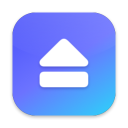
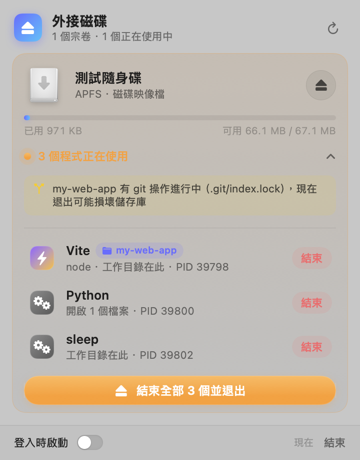
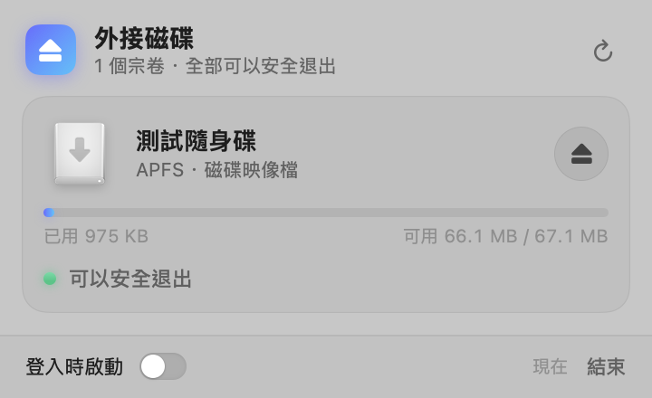

<p align="center">
  
</p>

<h1 align="center">Eject</h1>

<p align="center">
  <b>See what's blocking your external drive. Quit it. Eject safely.</b><br>
  A native macOS menu bar app built with Swift and SwiftUI
</p>

<p align="center">
  <b>English</b> · <a href="README.zh-TW.md">繁體中文</a>
</p>

<p align="center">
  
  
  
</p>

---

## Why?

You click Eject in Finder and get *"The disk wasn't ejected because one or more programs may be using it."* That's it. No name, no hint. Usually it's one of these:

- A Terminal tab that is still `cd`'d into the drive
- A Vite or Next.js dev server from `npm run dev` that never stopped
- VS Code with a project on the drive still open
- A Python script holding a file open

Eject lives in your menu bar and shows, **live**, whether each external drive can be ejected and what is holding it. You can quit the blockers and eject from the same panel, so you don't need Activity Monitor or `lsof`.

> [!NOTE]
> The app UI is currently in **Traditional Chinese**. Localization PRs are welcome (see [Contributing](#contributing)).

## Screenshots

| Drive in use | Safe to eject |
|:---:|:---:|
|  |  |

When an eject is blocked, a window pops up (dark mode):

<p align="center">
  
</p>

## Features

### See it

- **Status at a glance.** One card per external drive, showing capacity, file system and connection type (USB, Thunderbolt, SD card, disk image, network volume). A green dot means it's safe to eject. An orange dot means something is using it.
- **Menu bar icon reflects state.** It gets an exclamation badge when a drive is in use.
- **Accurate blocker detection.** Eject checks each process's **open files**, **working directory**, and whether its **executable lives on the drive**. It matches by device ID, not path prefix, so similarly named volumes (`USB` vs `USB 2`) never get mixed up.

### Understand it

- **Apps are grouped.** VS Code, Chrome and other apps spawn many helper processes. Eject folds them under the parent app and shows the app's own icon.
- **Host app is shown.** Command-line processes are labeled with the app they run inside, for example "zsh · in Terminal".
- **Dev servers are recognized.** Vite, Next.js, Nuxt, Astro, SvelteKit, Webpack, Parcel, Storybook, Jest, Vitest, `tsc --watch`, Django, Uvicorn, Flask, Jupyter, Streamlit, Claude Code and more. The **project name** is read from `package.json` (or the folder name).
- **Git protection.** If a `.git/index.lock` exists (git is in the middle of writing), Eject warns you before you pull the drive in the middle of a commit or rebase.

### Fix it

- **Checks before ejecting.** If blockers are already known, Eject shows them right away instead of attempting an unmount that is bound to fail.
- **Blocked-eject window.** Lists every blocker and the files it has open. Quit them one by one, or click "Quit all and eject". The window stays open even if you switch apps, and it updates live when you close something yourself.
- **Gentle termination:**

  | Target | What Eject does |
  |---|---|
  | GUI app | Sends a normal Quit, so the app can ask about unsaved documents. "Force Quit" is offered only if it hasn't quit after 8 seconds |
  | Command-line process | `SIGTERM`, then `SIGKILL` if it's still alive after 3 seconds |
  | Interactive shell | `SIGHUP` (same as closing the Terminal tab), because interactive shells ignore `SIGTERM` |

- **Force eject.** When no blocker is visible (usually a system process such as Spotlight or Time Machine), you can force eject. It asks for confirmation first.
- **Ejects the whole device.** For APFS volumes Eject finds the physical disk, unmounts every volume on it, then ejects it, just like Finder.
- **Also:** Eject All, right-click menu (Show in Finder, Force Eject), launch at login, dark mode, and a panel that resizes with its content and scrolls when there are more drives than fit on screen.

## Installation

Requires **macOS 14 Sonoma or later** and **Xcode 16 or later** (Swift 6 toolchain).

```bash
git clone https://github.com/YukiHataRin/eject.git
cd eject
./scripts/build-app.sh
```

The script:

1. Builds with `swift build -c release`
2. Draws the app icon programmatically
3. Assembles `Eject.app` and ad-hoc signs it
4. Installs it to `~/Applications` and launches it

A drive icon appears in the menu bar. To start Eject automatically, turn on "登入時啟動" (Launch at login) at the bottom of the panel.

> [!IMPORTANT]
> **Don't run the app from an external drive.** If Eject's own executable lives on a drive, Eject itself will block that drive from ejecting. The install script copies the app to `~/Applications`, and the drive's card shows a warning if Eject detects it is running from that drive.

Build without installing:

```bash
./scripts/build-app.sh --no-install   # output: build/Eject.app
```

Install somewhere else, for example `/Applications`:

```bash
INSTALL_DIR=/Applications ./scripts/build-app.sh
```

## Usage

1. Click the drive icon in the menu bar.
2. **Green drive:** click the ⏏ button to eject.
3. **Orange drive:** click "N 個程式正在使用" (N programs in use) to expand the list, then:
   - Click "結束" (Quit) next to a single program, or
   - Click "結束全部並退出" (Quit all and eject).
4. After ejecting, a banner confirms the drive is safe to unplug.

While the panel is open, Eject rescans every 2.5 seconds. When it's closed, it rescans every 20 seconds, just to keep the menu bar icon up to date. A full scan takes about 50 ms for roughly 800 processes.

## How it works

| Part | Technology |
|---|---|
| Menu bar UI | `NSStatusItem` plus a custom `NSPanel` hosting SwiftUI (`@Observable`). The panel resizes with its content, up to the screen's available height, and scrolls beyond that |
| Mount and unmount events | `DiskArbitration` appeared, disappeared and description-changed callbacks. Network volumes use `NSWorkspace` notifications |
| Physical device | Walks up the IORegistry to the topmost whole `IOMedia` (for APFS: `disk5s1` → synthesized `disk5` → physical `disk4`) |
| Finding blockers | `libproc`: `proc_listallpids`, `PROC_PIDLISTFDS`, `PROC_PIDFDVNODEPATHINFO` (open files), `PROC_PIDVNODEPATHINFO` (working directory), `proc_pidpath` (executable), matched against each volume's `st_dev` |
| App ownership | A process belongs to an app only if its executable is in that app's `.app/Contents/MacOS/`, or one of its ancestors is the app's main executable. So `/usr/bin/python3` (which actually runs Python inside Xcode) is never mistaken for Xcode |
| Command-line arguments | `sysctl(KERN_PROCARGS2)`, used to recognize dev servers |
| Unmount and eject | `DADiskUnmount` for each volume, then `DADiskEject` for the physical device. Failures are decoded from the `DADissenter` status code |
| Quitting processes | `NSRunningApplication.terminate()` / `forceTerminate()` and `kill(2)` |

## Limitations

- **System processes are invisible.** Without root, `libproc` can't read files opened by root processes (Spotlight's `mds`, Time Machine's `backupd`, and so on). When that happens, the window explains the likely cause and offers a force eject.
- **Memory-mapped files aren't scanned.** A program that only `mmap`s a file on the drive, with its file descriptor already closed, won't be detected. In practice such programs usually also have their working directory on the drive, so they're still caught.
- **Not on the App Store.** The App Store sandbox forbids reading other processes' information, so you build it yourself. This is also why similar tools are usually sold directly.
- **Not notarized.** The build script ad-hoc signs the app, which is fine for building on your own Mac. If you send the built `.app` to someone else, they'll need to allow it in System Settings › Privacy & Security.
- The first time Eject reads files on an external drive (to find project names and git state), macOS may ask whether to allow access to removable volumes.

## Development

```bash
swift build                              # debug build
.build/debug/Eject --scan                # print drives and blockers in the terminal, no UI
.build/debug/Eject --preview             # show the panel in a regular window for UI work
.build/debug/Eject --snapshot <dir>      # save the panel and blocker window as PNGs, then quit (add --dark for dark mode)
.build/debug/Eject --snapshot <dir> --only <volume name>   # only show one volume
.build/debug/Eject --panel-test <dir>    # open the real menu bar panel, log its size and screenshot it every second
EJECT_DEBUG_MAX_HEIGHT=500 .build/debug/Eject --panel-test <dir>   # simulate a short screen
```

Sample `--scan` output:

```
掃描 769 個程序，耗時 48 ms

■ 測試隨身碟  [APFS · 磁碟映像檔]  disk11s1 → 實體 disk10  dev=16777252
   • Vite ⚡︎Vite(my-web-app) — 工作目錄在此 · PID 38158
       /Volumes/測試隨身碟/my-web-app
   • Python — 開啟 1 個檔案 · PID 38160
       /Volumes/測試隨身碟/notes/todo.txt
   ⚠︎ git lock: /Volumes/測試隨身碟/my-web-app/.git/index.lock
```

To test without touching a real drive, use a disk image:

```bash
hdiutil create -size 64m -fs APFS -volname TestDrive test.dmg
hdiutil attach test.dmg
cd /Volumes/TestDrive && sleep 3600 &   # create a blocker
```

### Project structure

```
Sources/Eject/
├── EjectApp.swift                 # entry point, AppDelegate
├── Core/
│   ├── Models.swift               # volumes, blocking processes, groups
│   ├── DiskMonitor.swift          # DiskArbitration events, IOKit physical-device lookup
│   ├── ProcessScanner.swift       # libproc scan, app grouping, dev server and git lock detection
│   ├── ProcessTerminator.swift    # quitting apps and command-line processes
│   ├── Ejector.swift              # DADiskUnmount / DADiskEject wrappers
│   ├── AppModel.swift             # state and eject flow
│   └── DebugCLI.swift             # --scan, --preview, --snapshot, --eject-test
└── Views/
    ├── StatusItemController.swift # menu bar icon and auto-sizing panel
    ├── MenuPanel.swift            # panel: header, empty state, success banner, footer
    ├── VolumeCard.swift           # drive card
    ├── BlockerRow.swift           # blocker row
    ├── BlockerWindow.swift        # blocked-eject floating window
    └── Components.swift           # colors, status dot, capacity bar, buttons
scripts/
├── build-app.sh                   # build, bundle, sign, install
└── make-icon.swift                # draws the app icon
```

## Contributing

Issues and pull requests are welcome. Some ideas:

- **Localization:** an English UI (and other languages) via a String Catalog
- **More dev servers:** add rules to the `devTools` list in `ProcessScanner.swift`
- **System processes:** a privileged helper to detect blockers like Spotlight

## License

[MIT License](LICENSE) © 2026 YukiHataRin
