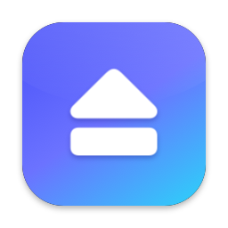
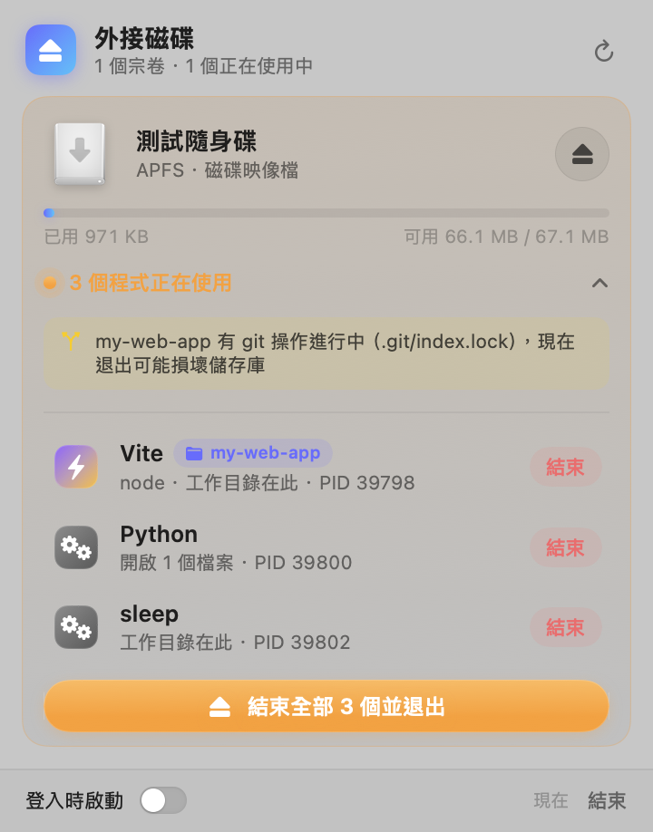
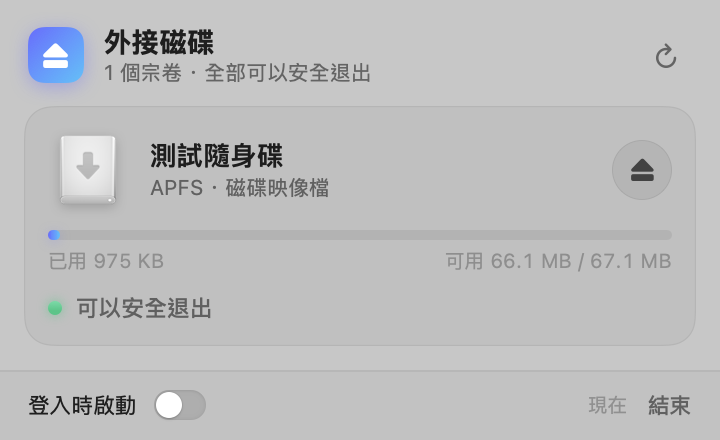
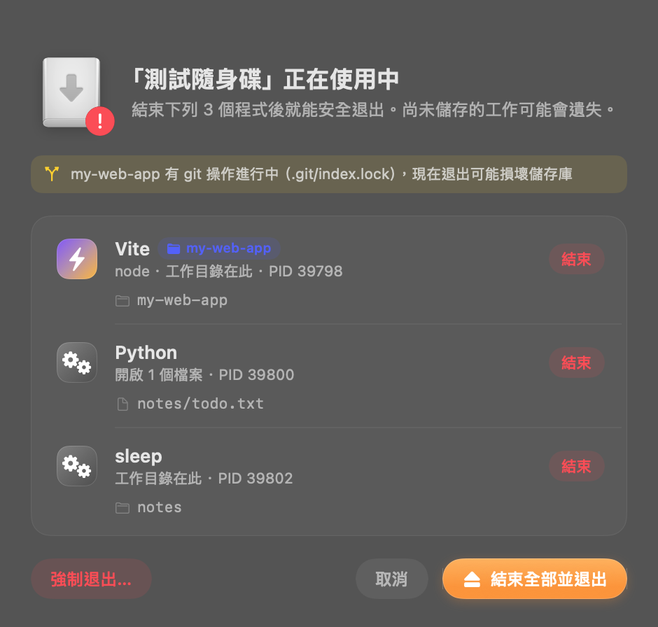

<p align="center">
  
</p>

<h1 align="center">Eject</h1>

<p align="center">
  <b>找出是誰占用外接磁碟，一鍵結束並安全退出。</b><br>
  原生 Swift／SwiftUI 打造的 macOS 選單列工具
</p>

<p align="center">
  <a href="README.md">English</a> · <b>繁體中文</b>
</p>

<p align="center">
  
  
  
</p>

---

## 為什麼需要這個工具？

在 Finder 按下退出，卻跳出「無法退出磁碟，因為一或多個程式正在使用它」——然後就沒有下文了。到底是哪個程式？可能是：

- 終端機分頁還 `cd` 在隨身碟裡
- `npm run dev` 的 Vite／Next.js dev server 還在跑
- VS Code 開著碟上的專案
- 某個 Python 腳本開著碟上的檔案

Eject 常駐在選單列，**即時**顯示每顆外接碟能不能退出、被誰占用，讓你直接結束那些程式後安全退出，不用再開「活動監視器」或在終端機打 `lsof`。

## 截圖

| 有程式占用時 | 可以安全退出時 |
|:---:|:---:|
|  |  |

退出被擋住時跳出的視窗（深色模式）：

<p align="center">
  
</p>

## 功能

### 看得見

- **狀態一目了然**：每顆外接碟一張卡片，顯示容量、格式、連接方式（USB、Thunderbolt、SD 卡、磁碟映像檔、網路宗卷）。綠燈代表可以安全退出，橘燈代表有程式占用。
- **選單列圖示會變**：有磁碟被占用時，圖示會加上驚嘆號。
- **精準找出占用者**：檢查每個程序**開啟的檔案**、**工作目錄**，以及**執行檔是否就在碟上**。比對的是裝置編號而不是路徑字串，所以名稱相近的宗卷（例如 `USB` 和 `USB 2`）不會誤判。

### 看得懂

- **App 自動分組**：VS Code、Chrome 這類 App 會啟動很多 helper 程序，Eject 會把它們歸到同一個 App 底下，用 App 本身的圖示顯示。
- **標出宿主 App**：命令列程序會註明是在哪個 App 裡執行，例如「zsh · 在 Terminal 中」。
- **辨識 dev server**：自動認出 Vite、Next.js、Nuxt、Astro、SvelteKit、Webpack、Parcel、Storybook、Jest、Vitest、`tsc --watch`、Django、Uvicorn、Flask、Jupyter、Streamlit、Claude Code 等，並從 `package.json`（或資料夾名稱）讀出**專案名稱**。
- **git 保護**：偵測到 `.git/index.lock`（git 正在寫入）時會先警告，避免在 commit 或 rebase 途中拔碟弄壞儲存庫。

### 處理得掉

- **退出前先檢查**：按下退出時，如果已經知道有人占用，會直接跳出視窗，不做注定失敗的卸載。
- **退出失敗視窗**：列出每個占用者和它開著的檔案。可以逐一結束，也可以按「結束全部並退出」一次搞定。這個視窗獨立於選單列面板，切到別的 App 也不會消失；你在別處手動關掉程式，清單也會自動更新。
- **溫和地結束程序**：

  | 對象 | 做法 |
  |---|---|
  | GUI App | 送出正常的「結束」指令，有未儲存的文件時 App 會先詢問；8 秒沒回應才提供「強制結束」 |
  | 命令列程序 | 送 `SIGTERM`，3 秒內沒結束再送 `SIGKILL` |
  | 互動式 shell | 送 `SIGHUP`（等同關閉終端機分頁），因為互動式 shell 會忽略 `SIGTERM` |

- **強制退出**：看不到占用者時（通常是 Spotlight、Time Machine 這類系統程序），可以選擇強制退出。需要再確認一次，避免誤按。
- **整顆裝置一起退出**：APFS 宗卷會追到實體磁碟，同一顆碟上的其他宗卷一起卸載後再退出，跟 Finder 的行為一致。
- **其他**：「全部退出」、右鍵選單（在 Finder 中顯示、強制退出）、登入時自動啟動、深色模式。

## 安裝

需要 **macOS 14 Sonoma 以上**，以及 **Xcode 16 以上**（Swift 6 工具鏈）。

```bash
git clone https://github.com/YukiHataRin/eject.git
cd eject
./scripts/build-app.sh
```

腳本會依序：

1. 用 `swift build -c release` 編譯
2. 用程式畫出 App 圖示
3. 組成 `Eject.app` 並做 ad-hoc 簽署
4. 安裝到 `~/Applications` 並啟動

完成後，選單列右上角會出現磁碟圖示。想開機自動啟動，在面板底部打開「登入時啟動」即可。

> [!IMPORTANT]
> **不要從外接碟直接執行 App。** App 的執行檔如果放在外接碟上，它自己就會擋住那顆碟的退出。安裝腳本會把 App 複製到 `~/Applications`；如果偵測到 App 正從某顆碟執行，卡片上也會跳出提醒。

只想打包、不安裝：

```bash
./scripts/build-app.sh --no-install   # 產物在 build/Eject.app
```

安裝到其他資料夾（例如 `/Applications`）：

```bash
INSTALL_DIR=/Applications ./scripts/build-app.sh
```

## 使用方式

1. 點選單列的磁碟圖示，打開面板。
2. 綠燈的碟：直接按右邊的 ⏏ 按鈕退出。
3. 橘燈的碟：點「N 個程式正在使用」展開清單，可以：
   - 按個別程式的「結束」
   - 按「結束全部並退出」
4. 退出成功後，面板上方會顯示「現在可以安全拔除」。

面板打開時每 2.5 秒重新掃描一次；關起來時放慢到每 20 秒一次，只用來更新選單列圖示。一次完整掃描大約 50 毫秒（約 800 個程序）。

## 運作原理

| 環節 | 使用的技術 |
|---|---|
| 選單列介面 | `NSStatusItem` ＋ 自訂 `NSPanel`，內容是 SwiftUI（`@Observable`）。面板會隨內容即時調整高度，最高到螢幕可用高度，超過就捲動 |
| 偵測掛載與卸載 | `DiskArbitration` 的 appeared／disappeared／description-changed 回呼；網路宗卷改用 `NSWorkspace` 通知 |
| 找出實體裝置 | 沿著 IORegistry 往上找最上層的 whole `IOMedia`（例如 APFS 的 `disk5s1` → 合成磁碟 `disk5` → 實體磁碟 `disk4`） |
| 找出占用程序 | `libproc`：`proc_listallpids`、`PROC_PIDLISTFDS`、`PROC_PIDFDVNODEPATHINFO`（開啟的檔案）、`PROC_PIDVNODEPATHINFO`（工作目錄）、`proc_pidpath`（執行檔），以 `st_dev` 比對宗卷 |
| App 歸屬 | 執行檔位於某個 `.app/Contents/MacOS/`，或祖先程序是該 App 的主程式，才算這個 App 的程序。所以 `/usr/bin/python3`（實際執行的是 Xcode 裡的 Python）不會被誤認成 Xcode |
| 命令列參數 | `sysctl(KERN_PROCARGS2)`，用來辨識 dev server |
| 卸載與退出 | `DADiskUnmount` 逐一卸載宗卷，再用 `DADiskEject` 退出實體裝置；失敗時解析 `DADissenter` 的狀態碼 |
| 結束程序 | `NSRunningApplication.terminate()`／`forceTerminate()`，以及 `kill(2)` |

## 限制

- **看不到系統程序**：沒有 root 權限時，`libproc` 讀不到 root 程序（Spotlight 的 `mds`、Time Machine 的 `backupd` 等）開啟的檔案。遇到這種情況，視窗會說明可能的原因並提供強制退出。
- **沒有掃描記憶體映射的檔案**：如果某程式只是用 `mmap` 映射碟上的檔案、但已經關閉檔案描述元，就偵測不到。實務上這類程式的工作目錄通常也在碟上，所以還是會被抓到。
- **無法上架 App Store**：App Store 的沙盒禁止讀取其他程序的資訊，所以只能自行編譯使用，這也是同類工具大多直接販售的原因。
- **未經公證（notarize）**：腳本做的是 ad-hoc 簽署，適合在自己的電腦上編譯使用。直接把編好的 `.app` 傳給別人時，對方需要在「系統設定 › 隱私權與安全性」允許開啟。
- 第一次讀取外接碟上的檔案（辨識專案名稱、檢查 git 狀態）時，macOS 可能會詢問是否允許 Eject 存取「卸除式宗卷」。

## 開發

```bash
swift build                              # 編譯 debug 版
.build/debug/Eject --scan                # 不開介面，在終端機印出外接碟與占用者
.build/debug/Eject --preview             # 把選單列面板放進一般視窗，方便調整介面
.build/debug/Eject --snapshot <資料夾>    # 把面板與占用視窗輸出成 PNG 後結束（加 --dark 為深色）
.build/debug/Eject --snapshot <資料夾> --only <宗卷名稱>   # 只顯示指定宗卷
.build/debug/Eject --panel-test <資料夾>  # 打開真正的選單列面板，每秒記錄大小並截圖
EJECT_DEBUG_MAX_HEIGHT=500 .build/debug/Eject --panel-test <資料夾>  # 模擬較矮的螢幕
.build/debug/Eject --anim-test <資料夾>   # 打開面板、展開再收合卡片，在動畫過程中逐格截圖
```

`--scan` 的輸出範例：

```
掃描 769 個程序，耗時 48 ms

■ 測試隨身碟  [APFS · 磁碟映像檔]  disk11s1 → 實體 disk10  dev=16777252
   • Vite ⚡︎Vite(my-web-app) — 工作目錄在此 · PID 38158
       /Volumes/測試隨身碟/my-web-app
   • Python — 開啟 1 個檔案 · PID 38160
       /Volumes/測試隨身碟/notes/todo.txt
   ⚠︎ git lock: /Volumes/測試隨身碟/my-web-app/.git/index.lock
```

想在不動到真實硬碟的情況下測試，可以建立一個磁碟映像檔：

```bash
hdiutil create -size 64m -fs APFS -volname 測試隨身碟 test.dmg
hdiutil attach test.dmg
cd /Volumes/測試隨身碟 && sleep 3600 &   # 製造一個占用者
```

### 專案結構

```
Sources/Eject/
├── EjectApp.swift              # 進入點、AppDelegate
├── Core/
│   ├── Models.swift            # 宗卷、占用程序、分組等資料結構
│   ├── DiskMonitor.swift       # DiskArbitration 監聽、IOKit 找實體裝置
│   ├── ProcessScanner.swift    # libproc 掃描、App 分組、dev server／git lock 辨識
│   ├── ProcessTerminator.swift # 結束 App 與命令列程序
│   ├── Ejector.swift           # DADiskUnmount／DADiskEject 包裝
│   ├── AppModel.swift          # 狀態管理與退出流程
│   └── DebugCLI.swift          # --scan、--preview、--snapshot、--eject-test
└── Views/
    ├── StatusItemController.swift # 選單列圖示與下拉面板（自動調整高度）
    ├── MenuPanel.swift         # 選單列面板（標題、空狀態、成功提示、底部列）
    ├── VolumeCard.swift        # 磁碟卡片
    ├── BlockerRow.swift        # 占用者列
    ├── BlockerWindow.swift     # 退出失敗浮動視窗
    └── Components.swift        # 色彩、狀態燈、容量條、按鈕等共用元件
scripts/
├── build-app.sh                # 編譯、打包、簽署、安裝
└── make-icon.swift             # 用程式畫 App 圖示
```

## 貢獻

歡迎開 Issue 或 Pull Request，例如：

- 新增 dev server 的辨識規則（在 `ProcessScanner.swift` 的 `devTools` 清單裡）
- 支援更多語言的介面
- 用特權 helper 讀取 root 程序，補上 Spotlight 等系統程序的偵測

## 授權

[MIT License](LICENSE) © 2026 YukiHataRin
